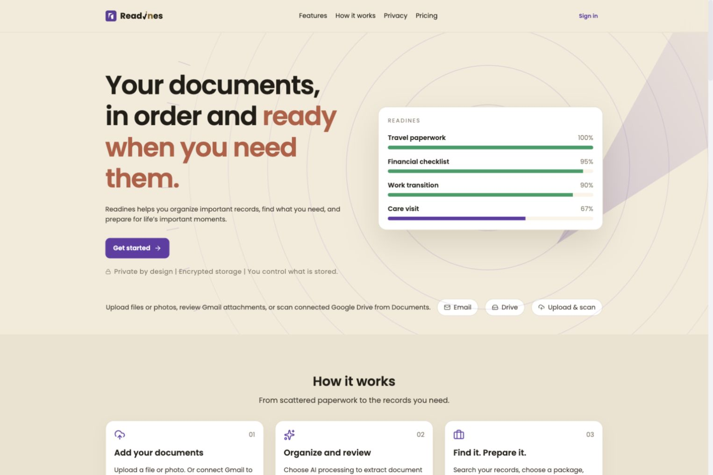
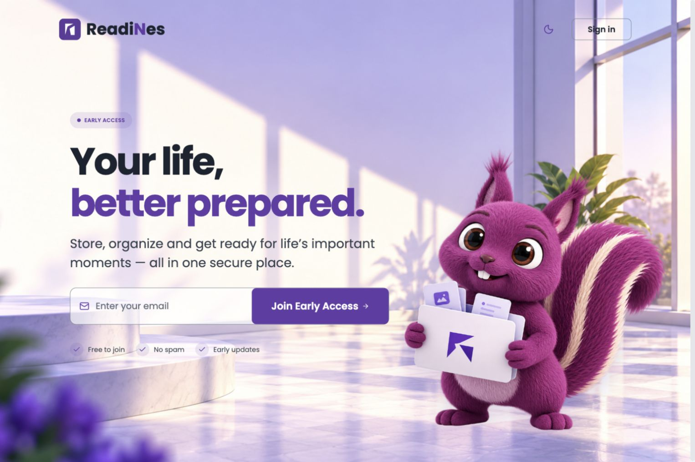
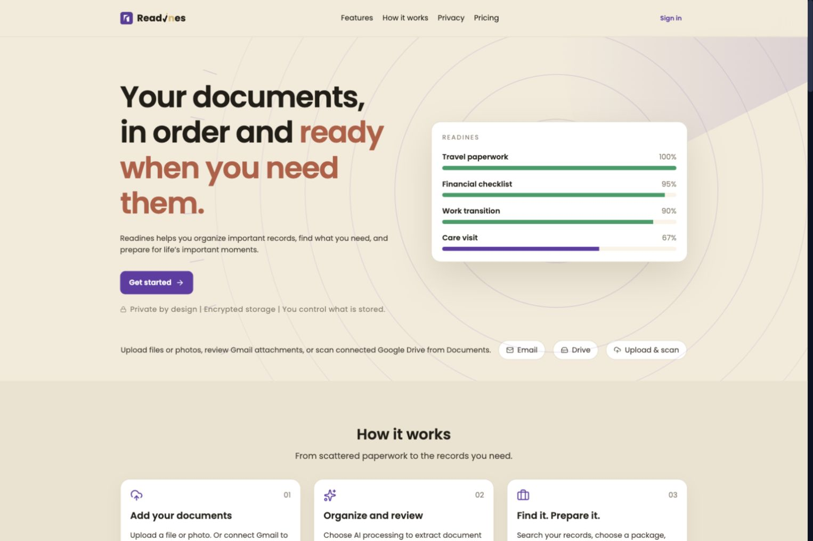
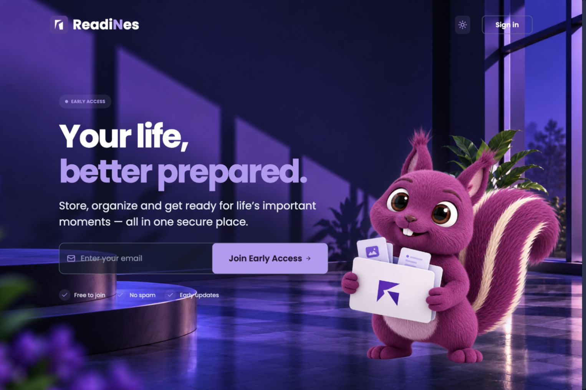
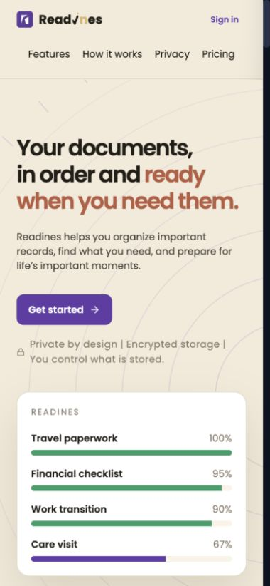
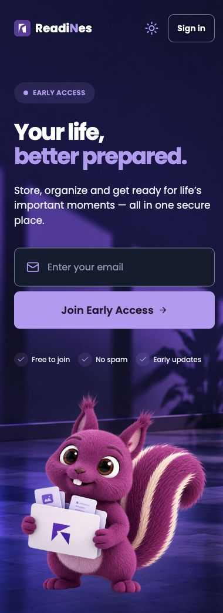

# Temporary early-access landing in the existing frontend

All implementation files live in `simplelifepack/frontend-web`, at `/Users/ranjith/code/frontend-web`. This is the existing React application with its existing package, Vite config, design system, theme provider and API clients. No second repository, application, deployment or backend change was created.

## Routing and restoration

`src/App.tsx` differs from the original app only by importing `TempLandingRoute` and switching the `/` route from `LandingRoute` to `TempLandingRoute`, with the original route retained in a comment. `LandingRoute` itself is byte-identical to the original. `/landing` and every other route definition remain unchanged.

`src/pages/landing/TempLandingRoute.tsx` renders `EarlyAccessLanding` with the existing session, explicit authentication and return-destination behavior. Restoring the original `/` requires switching just that route's component reference back to `LandingRoute`.

## Files

| File | Purpose |
| --- | --- |
| `src/App.tsx` | Import temporary route and switch only `/`. |
| `src/pages/landing/TempLandingRoute.tsx` | Temporary entry wrapper; preserves login/signup and return routing. |
| `src/App.session.test.tsx` | Verify temporary `/`, original `/landing`, and existing session/return behavior. |
| `src/components/EarlyAccessLanding.tsx` | Separate early-access page; existing auth modal and unsubscribe handling. |
| `src/components/EarlyAccessHero.tsx` | Existing brand components, theme switching, restored Sign In, accessible waitlist form and existing proof/register API. |
| `src/components/EarlyAccessHero.styles.ts` | Scoped responsive styles; exact light/dark background URLs with `cover`, preserving image aspect ratio. No recreated gradient backgrounds. |
| `src/components/EarlyAccessLanding.test.tsx` | Registration validation, loading/success, duplicate email, retry, unmount cancellation, Sign In and theme behavior. |
| `public/images/early-access-background-light.png` | Original supplied Lavender Light Modern Showroom PNG, byte-for-byte. |
| `public/images/early-access-background-dark.png` | Original supplied Midnight Atrium in Violet Light PNG, byte-for-byte. |
| `public/images/early-access-squirrel.png` | Original supplied folder-holding squirrel PNG, byte-for-byte, separate from background. |

The original `Landing*` component files, `src/pages/landing/index.tsx`, `BrandLogo.tsx`, design-system/theme files and waitlist API client have no diff from base `3434bfa`. No backend, payment, dependency, package, build configuration or deployment change is included.

## Validation

- `npm run lint`: passed.
- `tsc --noEmit`: passed.
- `VITE_API_URL=https://api.example.invalid npm run build`: passed; existing chunk-size warning remains. Placeholder HTTPS API is used only to compile, never for registrations.
- `vitest run src/components/EarlyAccessLanding.test.tsx src/components/Landing.test.tsx src/App.session.test.tsx src/lib/theme.test.ts`: 31 tests pass with the repository's normal configuration. No temporary test config is required in this checkout.
- Original `LandingRoute` function compared byte-for-byte with the base. The entire `App.tsx` diff contains only the temporary import and `/` element/comment change.
- Required files and assets were copied from the earlier same-repository Git worktree and byte-verified before removing that worktree. No remote repository or deployment was removed.
- Earlier browser checks verified both themes, 1536px desktop, 768px tablet, 390px mobile and 320px narrow layouts. Local mock-API registration covered success, duplicate email, simulated errors/retry; Sign In opened the existing modal. No production registration, live authenticated login, charges or email delivery were performed.
- Final browser validation was unavailable because local browser use was disabled in Work settings. Functional behavior is covered by tests; no fresh performance or network measurements are claimed for the route correction. The exact supplied PNGs remain unconverted and unchanged. Theme-specific CSS selects the active background; no code preloads the inactive image.

## Visual notes

The supplied room PNG backgrounds are used directly, without gradients or stretching; `cover` crops their edges to fit different viewports. The transparent mascot remains separate. The repository's official BrandMark/BrandWordmark and semantic palette remain authoritative, so they differ from the reference's wordmark spelling and vivid dark CTA. Layout refinements and Sign In restoration were made before the final routing correction; the routing correction itself does not change the design.

## Actual screenshots

Desktop images use a 1536×1024 viewport. Mobile images use a 390×844 viewport (some capture the full scrollable page). The original landing's brand surface used the same cream palette in both themes.

| Theme | Before | After |
| --- | --- | --- |
| Light desktop |  |  |
| Dark desktop |  |  |
| Dark mobile |  |  |

Screenshots were captured during earlier local browser QA. The light/dark desktop, tablet, mobile and registration-success captures show the supplied room backgrounds; the 320px and error/sign-in captures predate that background update. Browser automation was disabled in Work settings during the final route-transfer validation, so these are not fresh captures of the final route wiring.

Additional evidence: [light mobile](screenshots/after-light-mobile.jpg), [tablet](screenshots/after-dark-tablet.jpg), [320px mobile](screenshots/after-light-narrow.jpg), [registration success](screenshots/registration-success-mobile.jpg), [registration error](screenshots/registration-error-mobile.jpg), [prior sign-in validation, before button removal](screenshots/sign-in-mobile.jpg).
